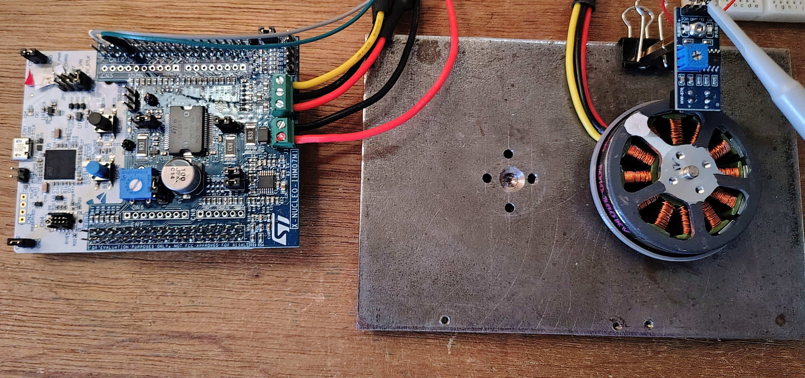
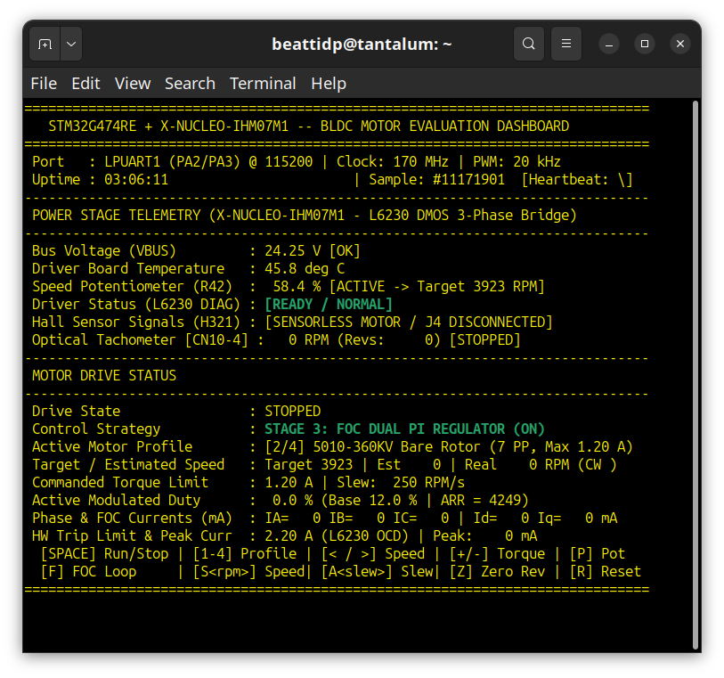
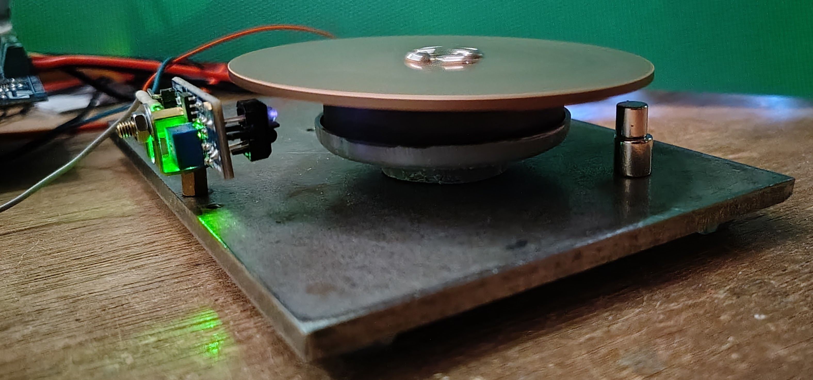
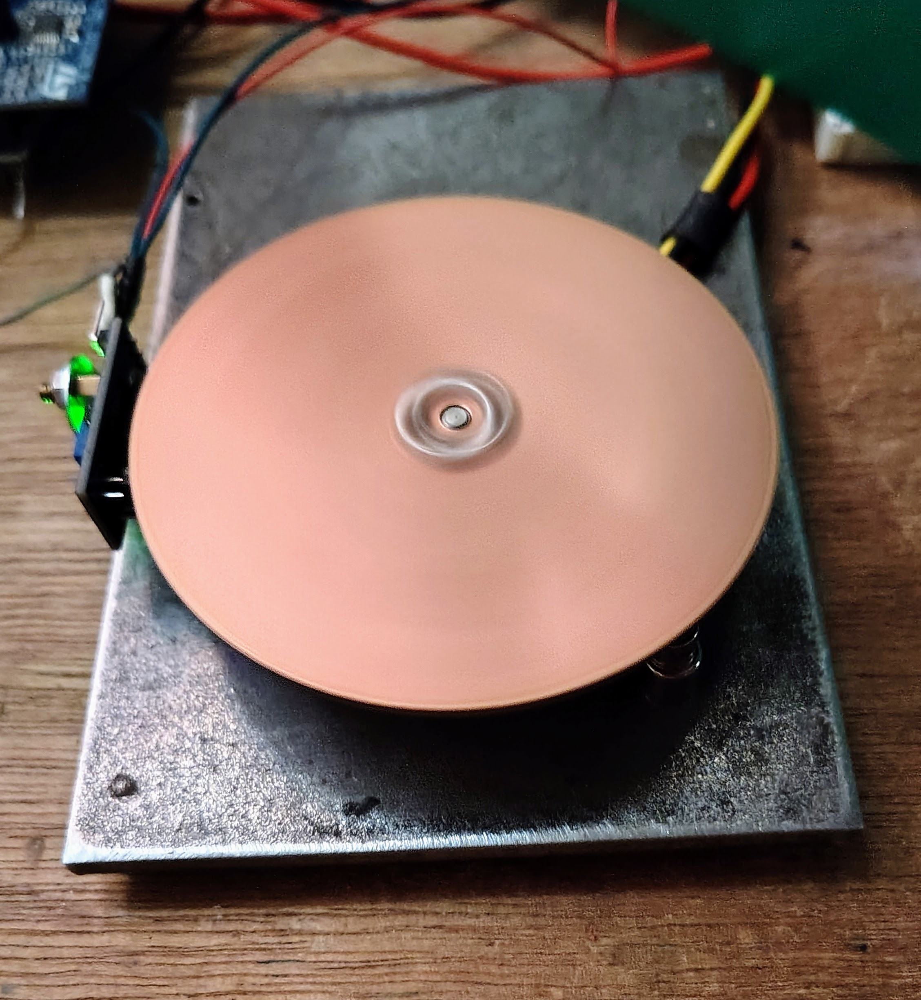

# x-nucleo-ihm07m1

_Evaluate the X-NUCLEO-IHM07M1 three-phase BLDC motor driver expansion board with the NUCLEO-G474RE development board._

 - PlatformIO with STM32Cube HAL
 - STM32G474RE @ 170 MHz
 - Experimental FOC features
 - Serial console dashboard with hot keys

Modified fixture with copper disc attached, optical tachometer moved to side and mounted permanently,
magnets beneath for eddy current torque load.

Modified fixture with copper disc spinning

---

### Credit where Credit is Due:
The code for this application was developed with [Google Antigravity](http://antigravity.google/).  _Thank you!_
