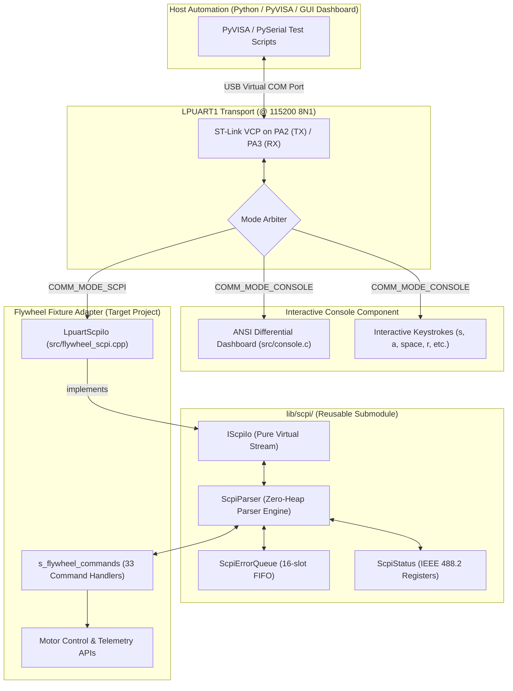

# Feature 17: Embedded SCPI Interface & Flywheel Test Fixture Automation

## 1. Executive Summary

This feature introduces a standards-compliant **SCPI (Standard Commands for Programmable Instruments)** and **IEEE 488.2** interface to the STM32G474RE + X-NUCLEO-IHM07M1 flywheel test fixture. 

The SCPI interface coexists with the interactive serial console over the ST-Link Virtual COM Port (LPUART1 @ 115200 baud). It enables programmatic control, automated verification suites, and host-side graphical dashboards (e.g. PyVISA, Python, LabVIEW, MATLAB) while maintaining a strict architectural boundary that keeps the SCPI parser engine reusable across other test fixtures.

---

## 2. System Architecture & Component Decoupling



---

## 3. Communication Mode Switching

Only one mode is active at any time:

| Communication Mode | Dashboard Rendering | Serial Stream Behavior | How to Enter |
| :--- | :--- | :--- | :--- |
| **Interactive Console** (`COMM_MODE_CONSOLE`) | Active (4 Hz partial ANSI refresh) | Interactive single keystrokes (`s<RPM>\r`, `space`, etc.) | Boot default, or send `:SYST:COMM:MODE CONSOLE` from SCPI |
| **SCPI Instrument** (`COMM_MODE_SCPI`) | **Muted** (Zero asynchronous output) | Strict Request-Response framing (`\r\n` terminated) | Type `*` or `:`, send `*IDN?`, or press hotkey `#` in console |

### Automatic Protocol Transition
When an automated host tool (such as PyVISA or `tools/test_scpi.py`) connects, it can send `*IDN?\n` or `:SYST:COMM:MODE SCPI\n`. The firmware automatically detects the `*` or `:` prefix, ungets the character, mutes the ANSI dashboard, and begins parsing SCPI commands with zero manual setup.

When the host script finishes, it sends `:SYST:COMM:MODE CONSOLE\n`, which immediately un-mutes the console and triggers a full screen refresh (`Console_RequestFullRedraw()`).

---

## 4. Flywheel SCPI Command Catalog

### 4.1. Mandatory IEEE 488.2 Common Commands

| Command | Type | Description | Return Format |
| :--- | :--- | :--- | :--- |
| `*IDN?` | Query | Instrument identification | `STMicroelectronics,STM32G474RE+<Board>,0,v1.2.0` |
| `*RST` | Command | Reset to safe defaults | Stops drive, clears faults, restores profile 1 |
| `*CLS` | Command | Clear status registers | Empties error queue, clears ESR and STB |
| `*OPC` | Command | Set Operation Complete | Sets bit 0 in ESR |
| `*OPC?` | Query | Query Operation Complete | Returns `1` |
| `*STB?` | Query | Query Status Byte | Decimal value (`0..255`) |
| `*ESR?` | Query | Query Event Status Register | Decimal value (`0..255`) (clears ESR on read) |
| `*ESE <val>` | Command | Set Event Status Enable | Mask (`0..255`) |
| `*ESE?` | Query | Query Event Status Enable | Mask (`0..255`) |
| `*SRE <val>` | Command | Set Service Request Enable | Mask (`0..255`) |
| `*SRE?` | Query | Query Service Request Enable | Mask (`0..255`) |
| `*TST?` | Query | Execute self-test | `0` (Pass) or `-240` (Hardware fault / VBUS low) |
| `*WAI` | Command | Wait to continue | Synchronous execution |

### 4.2. System Subsystem (`:SYSTem:`)

| Command / Query | Parameters | Description |
| :--- | :--- | :--- |
| `:SYSTem:ERRor[:NEXT]?` | None | Pops oldest error from queue: `<code >,"<message>"` |
| `:SYSTem:ERRor:COUNt?` | None | Returns integer number of unread errors (`0..16`) |
| `:SYSTem:VERSion?` | None | Returns SCPI version conformance: `1999.0` |
| `:SYSTem:COMMunication:MODE` | `<CONSOLE\|SCPI>` | Switches active communication mode |
| `:SYSTem:COMMunication:MODE?` | None | Returns current active mode (`SCPI` or `CONSOLE`) |

### 4.3. Motor Source & Output Subsystem (`:SOURce:MOTor:` and `:OUTPut:`)

| Command / Query | Parameters | Range | Description |
| :--- | :--- | :--- | :--- |
| `:OUTPut[:STATe]` | `<ON\|OFF\|1\|0>` | Boolean | Starts (`ON`) or stops (`OFF`) the motor drive |
| `:OUTPut[:STATe]?` | None | - | Returns `1` (running/starting) or `0` (stopped) |
| `:OUTPut:BRAKe` | None | - | Engages active controlled motor deceleration |
| `:SOURce:MOTor:SPEEd[:COMM]` | `<rpm>` | `0.0..10000.0` | Sets target mechanical speed in RPM |
| `:SOURce:MOTor:SPEEd?` | None | - | Returns current target mechanical speed |
| `:SOURce:MOTor:DIRection` | `<CW\|CCW>` | Enum | Sets rotation direction (+1 = CW, -1 = CCW) |
| `:SOURce:MOTor:DIRection?` | None | - | Returns `CW` or `CCW` |
| `:SOURce:MOTor:MODE` | `<SIXSTEP\|FOC\|OPENLOOP>` | Enum | Selects commutation algorithm mode |
| `:SOURce:MOTor:MODE?` | None | - | Returns `SIXSTEP`, `FOC`, or `OPENLOOP` |
| `:SOURce:MOTor:DUTY` | `<0.0..100.0>` | Float (%) | Sets manual open-loop PWM duty cycle |
| `:SOURce:MOTor:DUTY?` | None | - | Returns commanded PWM duty cycle percentage |
| `:SOURce:MOTor:SLEW:ACCEL` | `<rpm_s>` | `10.0..10000.0` | Sets acceleration slew rate in RPM/second |
| `:SOURce:MOTor:SLEW:DECEL` | `<rpm_s>` | `10.0..10000.0` | Sets deceleration slew rate in RPM/second |
| `:SOURce:MOTor:SLEW?` | None | - | Returns `<accel_slew>,<decel_slew>` |
| `:SOURce:MOTor:CURRent:LIMit` | `<amps>` | `0.1..5.0` | Sets software torque/current limit ceiling |
| `:SOURce:MOTor:CURRent:LIMit?` | None | - | Returns torque/current limit ceiling in Amps |
| `:SOURce:MOTor:POTentiometer[:STATe]` | `<ON\|OFF\|1\|0>` | Boolean | Enables/disables onboard speed potentiometer |
| `:SOURce:MOTor:POTentiometer?` | None | - | Returns `1` or `0` |
| `:SOURce:MOTor:PROFile:SELect` | `<1..4>` | Integer | Selects active motor profile index |
| `:SOURce:MOTor:PROFile:NAME?` | None | - | Returns active motor profile description |
| `:SOURce:MOTor:PROProfile:CATalog?` | None | - | Returns comma-separated list of motor profiles |

### 4.4. Measurement Subsystem (`:MEASure:`)

| Query | Return Format | Description |
| :--- | :--- | :--- |
| `:MEASure:VOLTage[:DC]?` | `<float>` | DC Bus voltage ($V_{bus}$) in Volts |
| `:MEASure:TEMPerature?` | `<float>` | Driver temperature in $^{\circ}\text{C}$ |
| `:MEASure:SPEEd:OPTIcal?` | `<float>` | Optical tachometer speed in RPM |
| `:MEASure:SPEEd:HALL?` | `<float>` | 3-Phase Hall sensor estimated speed in RPM |
| `:MEASure:SPEEd[:ACTUal]?` | `<float>` | Active measured speed in RPM |
| `:MEASure:CURRent:PEAK?` | `<float>` | Instantaneous peak phase current in Amps |
| `:MEASure:CURRent:PHASe:ALL?` | `<ia>,<ib>,<ic>` | Three-phase currents in Amps |
| `:MEASure:CURRent:DQ?` | `<id>,<iq>` | FOC direct and quadrature currents in Amps |
| `:MEASure:PULSe:OPTIcal?` | `<integer>` | Cumulative optical revolution pulse count |
| `:MEASure:TELEmetry:ALL?` | Single CSV Line | **High-Throughput Polling Line** (see below) |

#### High-Throughput Telemetry Format (`:MEAS:TELE:ALL?`):
Emits a single comma-separated line containing all synchronized channels in $< 1\text{ ms}$:
```text
<vbus>,<temp>,<act_rpm>,<opt_rpm>,<hall_rpm>,<iq>,<id>,<ipeak>,<duty>,<stalled>,<fault>,<pulses>
```
*Example:* `16.02,26.8,1440.0,1440.2,1439.8,0.245,-0.010,0.480,24.5,0,0,1250`

### 4.5. Diagnostics & Characterization Subsystem (`:TEST:` and `:FAULt:`)

| Command / Query | Parameters | Description |
| :--- | :--- | :--- |
| `:TEST:STALL?` | None | Returns `1` if motor stall is detected, `0` otherwise |
| `:TEST:SLIP?` | None | Returns `1` if rotor slip / harmonic decoupling is detected |
| `:TEST:OPTIcal:RESet` | None | Resets optical revolution pulse counter to zero |
| `:TEST:CALibrate:CURRent` | None | Triggers zero-current dynamic ADC shunt calibration |
| `:TEST:CHARacterize:START` | None | Initiates automated motor characterization sequence |
| `:TEST:CHARacterize:ABORt` | None | Aborts automated characterization |
| `:TEST:CHARacterize:STATe?` | None | Returns `<state_name>,<progress_pct>` |
| `:TEST:CHARacterize:RESults?` | None | Returns `<Rs_ohm>,<Kv>,<Ke>,<base_duty>,<vf_slope>` |
| `:TEST:CHARacterize:APPLy` | None | Commits characterized parameters to active profile |
| `:FAULt:RESet` | None | Clears driver fault state |
| `:FAULt:STATe?` | None | Returns `1` if DIAG pin active, `0` if normal |

---

## 5. Verification & Tooling

### Automated Verification Script (`tools/test_scpi.py`)
Run the test script directly from host:
```bash
python3 tools/test_scpi.py --port /dev/ttyACM0 --baud 115200
```

### Host Unit Test Suite (`lib/scpi/test/`)
Run the standalone unit test suite off-target:
```bash
make -C lib/scpi/test
```
All 10 unit tests validate short/long forms, optional nodes, parameter parsing, error queue FIFO, and status byte registers.
