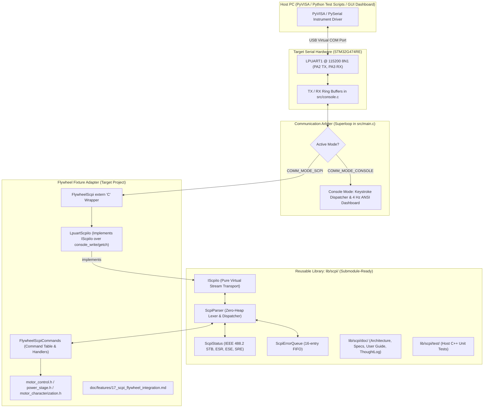

# Master Implementation Plan: SCPI Parser and Flywheel Test Fixture Automation

This document captures the implementation plan for the **PlatformIO-native, submodule-ready SCPI engine** in [`lib/scpi/`](file:///home/beattidp/Documents/antigravity/x-nucleo-ihm07m1/lib/scpi), the architectural boundary models, module technical reference specifications, and flywheel fixture automation commands.

---

## 1. Architectural Boundary Model

The architectural boundary strictly isolates the generic protocol engine from the target hardware transport and the flywheel motor control logic:



### Boundary Guarantees:
1. **`lib/scpi/` Independence:** Can be compiled on Linux with `g++` without including a single STM32 or motor header.
2. **Deterministic Embedded Footprint:** Zero runtime dynamic heap allocation (`malloc`/`new`). Static memory buffers for line accumulation (256 B), response formatting (256 B), and error queue (16 entries).
3. **Pluggable Transport (`IScpiIo`):** The core parser only knows how to read/write bytes through `IScpiIo`. The target project provides `LpuartScpiIo`, which connects to `console_getch()` and `console_write()`.

---

## 2. Documentation Strategy

Documentation is partitioned into **Module Technical Reference Documents**, a **User Guide & Refresher**, and **Fixture-Specific Integration Documentation**:

```text
lib/scpi/doc/                                # Reusable Library Documentation (travels with submodule)
├── architecture.md                          # Class diagrams, zero-alloc memory model, state machine
├── ieee488_2_compliance.md                  # Mandatory common commands & IEEE 488.2 status registers
├── extensibility_guide.md                   # Step-by-step guide for declaring commands on new fixtures
├── user_guide.md                            # Quickstart, syntax refresher, parameter rules, terminal testing
├── ThoughtLog.md                            # Context-specific thought log for lib/scpi development
└── walkthrough.md                           # Reusable implementation walkthrough copy

doc/                                         # Flywheel Test Fixture Project Documentation
├── ThoughtLog.md                            # Global project chain-of-thought log
├── walkthrough.md                           # Master system walkthrough & feature index
├── implementation_plan.md                   # Master implementation plan
├── features/
│   ├── 00_initial_nucleo_ihm07m1_bringup.md # Historical baseline bringup
│   ├── ...
│   └── 17_scpi_flywheel_integration.md      # Flywheel SCPI command dictionary & PyVISA test setup
└── worklogs/
```

---

## 3. Compliant Minimal SCPI Implementation

### 3.1. Mandatory IEEE 488.2 Common Commands

| Command | Type | Description | Target Action |
| :--- | :--- | :--- | :--- |
| `*IDN?` | Query | Identification query | Returns `STMicroelectronics,STM32G474RE+<Board>,0,v1.2.0` |
| `*RST` | Command | Reset to default state | Stops motor, resets speed to default, clears temporary faults, restores active profile defaults |
| `*CLS` | Command | Clear status | Clears Error Queue, clears ESR, resets Questionable/Operation status registers |
| `*OPC` | Command | Operation complete | Sets Operation Complete bit (bit 0) in ESR when current task finishes |
| `*OPC?` | Query | Operation complete query | Returns `1\r\n` when pending motor commands or calibrations finish |
| `*STB?` | Query | Read status byte | Returns decimal value of Status Byte Register (`STB`) |
| `*ESR?` | Query | Read event status register | Returns decimal value of Standard Event Status Register (`ESR`) and clears it |
| `*ESE <val>` | Command | Set event status enable | Sets the mask for ESR |
| `*ESE?` | Query | Query event status enable | Returns current ESR mask |
| `*SRE <val>` | Command | Set service request enable | Sets the mask for STB |
| `*SRE?` | Query | Query service request enable| Returns current STB mask |
| `*TST?` | Query | Self-test query | Checks VBUS voltage in range, driver DIAG pin healthy, shunt offsets calibrated. Returns `0` (Pass) or error code |
| `*WAI` | Command | Wait-to-continue | Delays processing of subsequent commands until current atomic action finishes |

### 3.2. Standard SCPI System & Status Subsystems

| Command / Query | Description | Response / Action |
| :--- | :--- | :--- |
| `:SYSTem:ERRor[:NEXT]?` | Retrieves and pops oldest error from queue | `<code >,"<description>"` (e.g. `0,"No error"`) |
| `:SYSTem:ERRor:COUNt?` | Queries number of unread errors in queue | Integer count `0..16` |
| `:SYSTem:VERSion?` | Queries SCPI version conformance | `1999.0` |
| `:SYSTem:COMMunication:MODE <CONSOLE\|SCPI>` | Mode switcher | Switches active communication protocol |
| `:SYSTem:COMMunication:MODE?` | Queries active mode | `SCPI` or `CONSOLE` |

---

## 4. Flywheel Test Fixture SCPI Command Catalog

### 4.1. Motor Drive & Output Subsystem (`:SOURce:MOTor:` and `:OUTPut:`)

| Command / Query | Parameters | Description |
| :--- | :--- | :--- |
| `:OUTPut[:STATe]` | `<ON\|OFF\|1\|0>` | Starts or stops the motor drive (`Motor_Start()` / `Motor_Stop()`) |
| `:OUTPut[:STATe]?` | None | Returns `1` if running/starting, `0` if stopped/fault |
| `:OUTPut:BRAKe` | None | Engages active controlled braking (`Motor_Brake()`) |
| `:SOURce:MOTor:SPEEd[:COMM]` | `<rpm>` | Sets target mechanical RPM (e.g. `50.0` to `10000.0`) |
| `:SOURce:MOTor:SPEEd?` | None | Queries current target mechanical RPM |
| `:SOURce:MOTor:DIRection` | `<CW\|CCW\|1\|-1>` | Sets motor direction (+1 = CW, -1 = CCW) |
| `:SOURce:MOTor:DIRection?` | None | Returns `CW` or `CCW` |
| `:SOURce:MOTor:MODE` | `<SIXSTEP\|FOC\|OPENLOOP>` | Selects commutation algorithm mode |
| `:SOURce:MOTor:MODE?` | None | Returns active mode keyword |
| `:SOURce:MOTor:DUTY` | `<0.0..100.0>` | Sets commanded duty cycle percentage |
| `:SOURce:MOTor:DUTY?` | None | Queries active commanded duty cycle percentage |
| `:SOURce:MOTor:SLEW:ACCEL` | `<rpm_s>` | Sets acceleration slew rate in RPM/second |
| `:SOURce:MOTor:SLEW:DECEL` | `<rpm_s>` | Sets deceleration slew rate in RPM/second |
| `:SOURce:MOTor:SLEW?` | None | Returns `<accel_slew>,<decel_slew>` |
| `:SOURce:MOTor:CURRent:LIMit` | `<amps>` | Sets continuous torque/current limit ceiling in Amps |
| `:SOURce:MOTor:CURRent:LIMit?` | None | Queries torque/current limit |
| `:SOURce:MOTor:POTentiometer[:STATe]`| `<ON\|OFF\|1\|0>` | Enables/disables onboard speed potentiometer control |
| `:SOURce:MOTor:POTentiometer?` | None | Returns `1` or `0` |
| `:SOURce:MOTor:PROFile:SELect` | `<1..4>` | Selects active motor profile index |
| `:SOURce:MOTor:PROFile:NAME?` | None | Returns active motor profile name string |
| `:SOURce:MOTor:PROFile:CATalog?` | None | Returns comma-separated list of profile names |

### 4.2. Sensing & Measurement Subsystem (`:MEASure:`)

| Query | Return Format | Description |
| :--- | :--- | :--- |
| `:MEASure:VOLTage:DC?` | `<float> V` (e.g. `16.02`) | DC Bus voltage ($V_{bus}$) |
| `:MEASure:TEMPerature?` | `<float> C` (e.g. `27.4`) | Driver board temperature in $^{\circ}\text{C}$ |
| `:MEASure:SPEEd:OPTIcal?` | `<float> RPM` (e.g. `1440.5`) | Precision optical tachometer speed |
| `:MEASure:SPEEd:HALL?` | `<float> RPM` | Speed computed from 3-phase Hall transition periods |
| `:MEASure:SPEEd[:ACTUal]?` | `<float> RPM` | Active measured speed |
| `:MEASure:CURRent:PEAK?` | `<float> A` (e.g. `0.65`) | Peak instantaneous phase current |
| `:MEASure:CURRent:PHASe:ALL?` | `<ia>,<ib>,<ic>` | Instantaneous currents on phases A, B, and C |
| `:MEASure:CURRent:DQ?` | `<id>,<iq>` | Direct and quadrature currents ($I_d$, $I_q$) in Amps |
| `:MEASure:PULSe:OPTIcal?` | `<integer>` | Cumulative optical revolution pulse count |
| `:MEASure:TELEmetry:ALL?` | Single CSV line | **High-efficiency PyVISA polling query**: Returns `<vbus>,<temp>,<actual_rpm>,<optical_rpm>,<hall_rpm>,<iq>,<id>,<peak_curr>,<duty>,<stalled>,<fault>,<pulse_count>` |

### 4.3. Test & Diagnostic Subsystem (`:TEST:` and `:FAULt:`)

| Command / Query | Parameters | Description |
| :--- | :--- | :--- |
| `:TEST:STALL?` | None | Returns `1` if motor stall detected, `0` otherwise |
| `:TEST:SLIP?` | None | Returns `1` if rotor slip / harmonic decoupling detected |
| `:TEST:OPTIcal:RESet` | None | Resets cumulative optical revolution count to zero |
| `:TEST:CALibrate:CURRent` | None | Triggers dynamic zero-current ADC shunt calibration |
| `:TEST:CHARacterize:START` | None | Initiates automated motor characterization sequence |
| `:TEST:CHARacterize:ABORt` | None | Aborts automated characterization |
| `:TEST:CHARacterize:STATe?` | None | Returns `<state_name>,<progress_pct>` |
| `:TEST:CHARacterize:RESults?` | None | Returns `<Rs_ohm>,<Kv>,<Ke>,<base_duty>,<vf_slope>` |
| `:TEST:CHARacterize:APPLy` | None | Commits characterization results to the active profile |
| `:FAULt:RESet` | None | Clears hardware driver fault state |
| `:FAULt:STATe?` | None | Returns `1` if DIAG line active/low, `0` if normal |
