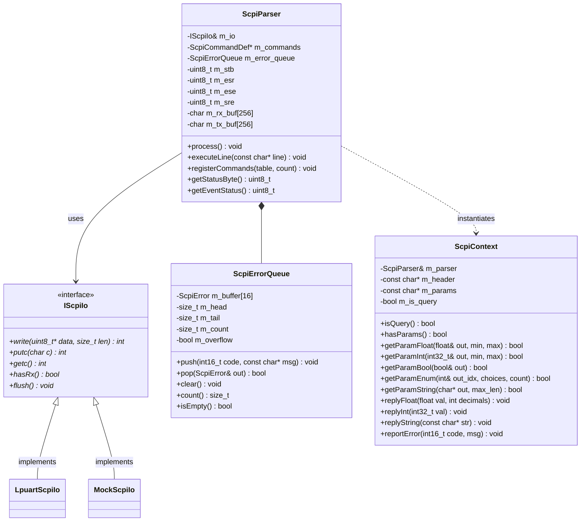

# Embedded SCPI Parser Architecture & Design Specification

## 1. Overview & Architectural Goals

The `lib/scpi` library provides a high-performance, standards-compliant SCPI (Standard Commands for Programmable Instruments) parser tailored for embedded 32-bit microcontrollers (ARM Cortex-M / STM32) and automated test fixtures.

### Key Architectural Pillars
1. **Zero Runtime Dynamic Allocation**: No `malloc`, `new`, or standard heap allocations during line tokenization, parameter parsing, or error management. Prevents heap fragmentation in high-frequency motor control firmware.
2. **Strict Protocol Decoupling (`IScpiIo`)**: Pure abstract stream transport isolating the parser from physical hardware (UART, USB-CDC, Ethernet, TCP/IP, or host-based mock streams).
3. **Standards-Compliant SCPI-99 & IEEE 488.2**: Supports mandatory common commands, hierarchical command trees, short/long form matching (3/4 letter rules), optional syntax nodes (`[:NODE]`), semicolon chaining (`;`), IEEE 488.2 status registers (`STB`, `ESR`, `ESE`, `SRE`), and a standard 16-slot FIFO error queue (`:SYST:ERR?`).
4. **Declarative Extensibility**: Adding new commands and queries to any test fixture requires only a single static table entry and a callback function utilizing type-safe `ScpiContext` parameter extractors.
5. **Seamless C Linkage**: Implemented in clean, modern C++14, wrapped with an `extern "C"` interface for linking with legacy or pure-C firmware codebases.

---

## 2. System Class Diagram & Boundary



---

## 3. Command Execution Lifecycle & Semicolon Chaining

When a line arrives over the transport, `ScpiParser::executeLine()` processes the stream through three distinct phases:

```mermaid
sequenceDiagram
    participant Host as Host (PyVISA / Terminal)
    participant IO as IScpiIo
    participant Parser as ScpiParser
    participant Queue as ScpiErrorQueue
    participant Handler as Command Handler

    Host->>IO: "SOUR:MOT:SPEE 1200;*OPC?\n"
    Note over Parser: process() detects newline
    Parser->>Parser: Semicolon Tokenizer splits into Subcommands
    
    rect rgb(240, 248, 255)
        Note over Parser: Subcommand 1: "SOUR:MOT:SPEE 1200"
        Parser->>Parser: Match header against s_flywheel_commands
        Parser->>Handler: handle_speed(ctx) with param "1200"
        Handler->>Handler: Motor_SetSpeed(1200.0f)
    end

    rect rgb(245, 255, 250)
        Note over Parser: Subcommand 2: "*OPC?"
        Parser->>Parser: Built-in IEEE 488.2 handler
        Parser->>Parser: Append "1" to tx_buf
    end

    Parser->>IO: flushResponse() -> writes "1\r\n"
    IO->>Host: "1\r\n"
```

---

## 4. Pattern Matching & The 3/4-Letter SCPI Rule

The SCPI standard defines a strict mnemonic truncation rule:
1. If the command keyword has 4 letters or fewer, the short form is identical to the long form (e.g. `DC` $\to$ `DC`, `ALL` $\to$ `ALL`).
2. If the keyword has more than 4 letters:
   - If the 4th letter is a consonant, the short form is the first 4 letters (e.g. `SOURce` $\to$ `SOUR`, `MEASure` $\to$ `MEAS`, `SPEEd` $\to$ `SPEE`).
   - If the 4th letter is a vowel, the short form is the first 3 letters (e.g. `OUTPut` has 'P' consonant $\to$ `OUTP`).
3. Matching rules:
   - Case-insensitive.
   - Incoming token must match **either** the short form **or** the full long form. Intermediate lengths (e.g. `SOURC`) are strictly rejected and generate `-113, "Undefined header"`.
4. Optional nodes in brackets (`[:COMManded]`, `[:STATe]`, `[:DC]`):
   - Matched if present in the header.
   - Transparently bypassed if omitted from the header.

---

## 5. Memory Footprint Analysis

| Resource | Size (Bytes) | Allocation Type | Purpose |
| :--- | :--- | :--- | :--- |
| `m_rx_buf` | 256 | Static / Member | Accumulates incoming characters until `\r` or `\n` |
| `m_tx_buf` | 256 | Static / Member | Formats query response string before flushing |
| `m_error_queue` | 800 | Static / Member | 16 entries $\times$ 50 bytes (code + message string) |
| `ScpiParser` instance | ~1.4 KB | BSS / Static | Full parser state, register masks, and pointers |
| Stack usage | $< 256$ B | Local stack | Frame for node token slices and local string buffers |
| Heap usage | **0 Bytes** | None | No `malloc`, `free`, or `new` permitted |
